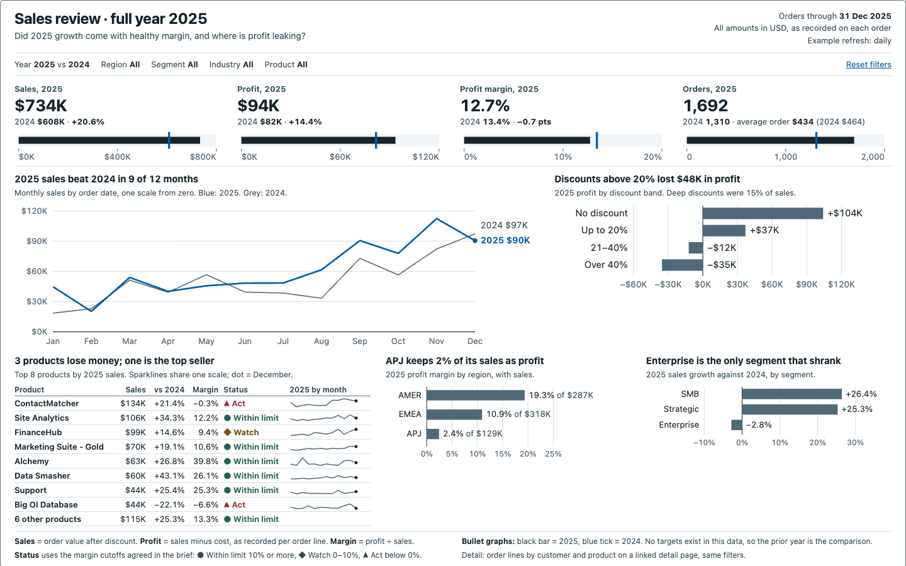
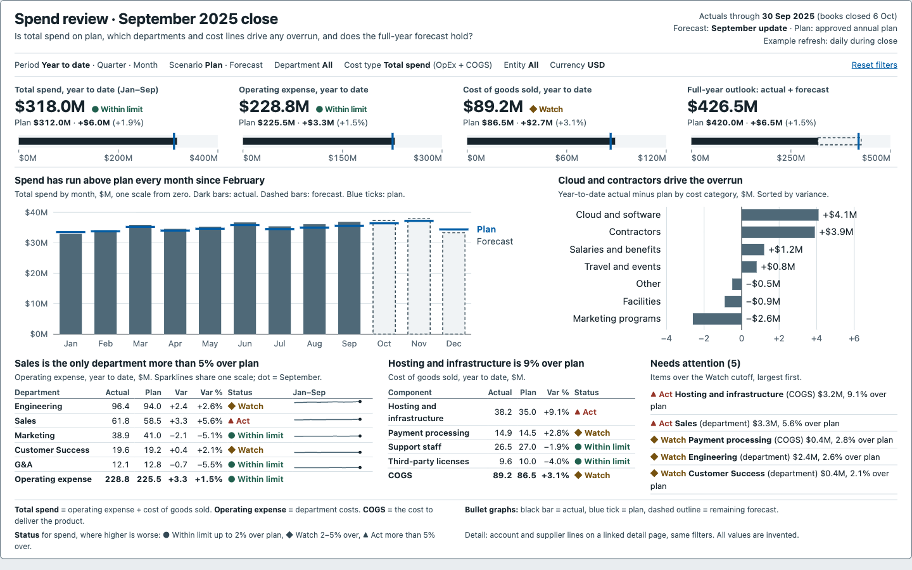
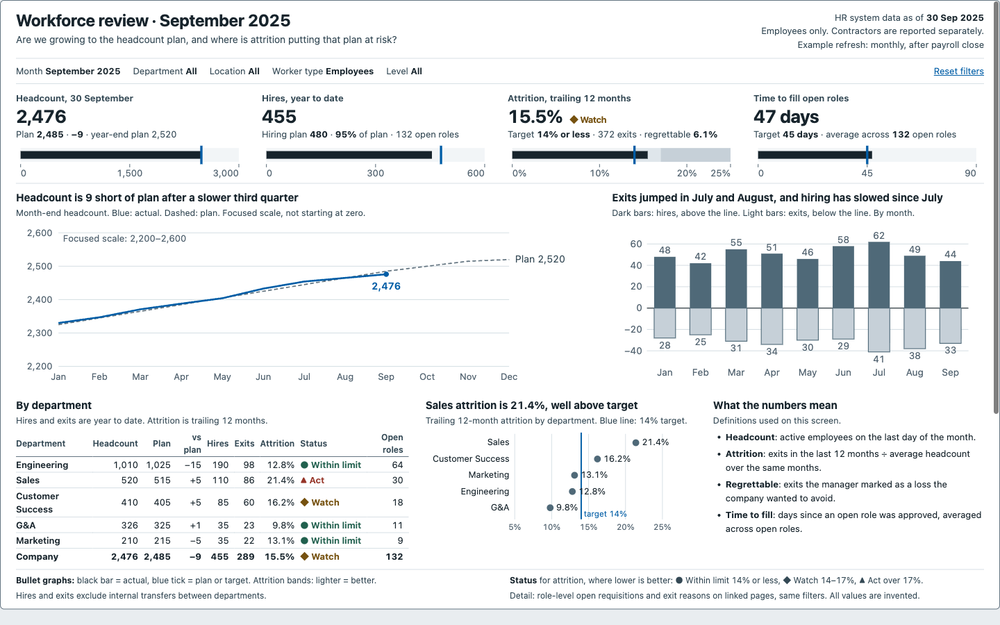

# Dashboard Design Standard

**A day-to-day design reference for BI developers who build monitoring dashboards.**

**[Read the standard](https://bronsonelliott.github.io/dashboard-design-standard/)** · [Rule reference](rules.md) · [Download the HTML](index.html)

---

## The Problem This Solves

Most dashboard reviews turn into taste arguments. One person likes the gauge. Someone else hates the pie chart. Nobody can point to a rule, so the loudest opinion wins and the next dashboard repeats the same mistakes.

A design standard fixes that. Every rule has an ID, a level and a check you can actually run. A review comment stops being "I don't like this" and becomes "this breaks AVD-01."

---

## What's Inside

- **16 sections**, from what a dashboard is (and when a request is really a report) to a pre-release checklist.
- **64 rules with stable IDs.** 38 MUST, 24 SHOULD and 2 GUIDANCE.
- **A chart gallery** with every recommended display, drawn with invented sample data.
- **Side-by-side corrections** for pie charts, gauges, 3-D bars, truncated axes, rainbow color, dual axes and decorative maps.
- **A full color palette** with hex values and contrast ratios.
- **Four dashboard types** (strategic, operational, analytical monitoring and tactical) with a decision guide and a worked example for each.
- **A one-page brief template** and the interview questions behind it.
- **A before-and-after redesign** of a complete dashboard, with every problem tied to a rule ID.

It's one HTML file. No libraries, no fonts, no network calls. It works offline and includes print styles.

---

## Examples

Three single-screen dashboards built to the standard. Under each screen you'll find its brief, the rules it applies and where the data came from.

**[Sales review](https://bronsonelliott.github.io/dashboard-design-standard/examples/sales-review.html).** A full-year review built from a public SaaS sales sample dataset. Sales grew 21%, but deep discounts ate into the margin.

**[Finance spend review](https://bronsonelliott.github.io/dashboard-design-standard/examples/finance-spend-review.html).** Operating expense, COGS and total spend against plan and forecast at month-end close. Invented data.

**[HR workforce review](https://bronsonelliott.github.io/dashboard-design-standard/examples/hr-workforce-review.html).** Headcount against plan, hires, exits and attrition by department. Invented data.

---

## How to Use It

**If you lead a BI team:** start with sections 1 to 3. They cover what a dashboard is, how the rule levels work and how to pick a dashboard type. Then decide whether to adopt the standard as is or fork it and change the levels to fit your team.

**If you build dashboards:** write the brief first (section 4), use the selection guide to pick charts (section 6) and run the checklist before release (section 14). Cite rule IDs in reviews and tickets.

**If you use an AI assistant:** point it at [rules.md](rules.md). It has every rule and every color in plain tables, so the assistant can check a design and cite the rule it breaks.

The rule levels mean something:

| Level | Meaning |
|:---|:---|
| **MUST** | Breaking it can mislead a reader, hide a signal the decision needs, block access or skip a release control. It blocks release. |
| **SHOULD** | A strong default with real exceptions. Breaking it needs a written reason. |
| **GUIDANCE** | A judgment call. Use it when it helps. |

---

## Built on Stephen Few

The method follows [Stephen Few](https://www.perceptualedge.com/)'s work on information dashboard design. One screen. Context for every number. Simple displays over decoration. Bullet graphs and sparklines instead of gauges and pies.

The wording, examples and data are all original. Anything that goes beyond Few, like modern accessibility rules, is labeled as an addition in the document.

To go to the source, start at [Perceptual Edge](https://www.perceptualedge.com/), Few's site.

---

## How It Was Built

I wrote one detailed prompt describing the standard I wanted and gave it to eight AI models. Each output was scored against that prompt for completeness, accuracy, visual quality and how well its rules held up. Then I merged the strongest parts into one document. When two parts disagreed, the higher-scoring model's version won.

The last step was re-tiering the rule levels. The merged draft marked 50 of 64 rules as MUST, so nothing stood out. Now 38 are, picked with a written test that sits in section 2.

---

## Companion Work

**[Report Tiering Framework](https://github.com/bronsonelliott/report-tiering-framework)** decides how much quality, ownership and support a dashboard gets. This standard decides how it looks and reads. The two share most of their dashboard types, so they work well together.

---

## License

[CC BY 4.0](LICENSE). Use it, change it and share it. Just credit this repo.

---

*Created by Bronson Elliott · [LinkedIn](https://www.linkedin.com/in/bronsonelliott) · [Learning Out Loud on Substack](https://bronsonelliott.substack.com)*
